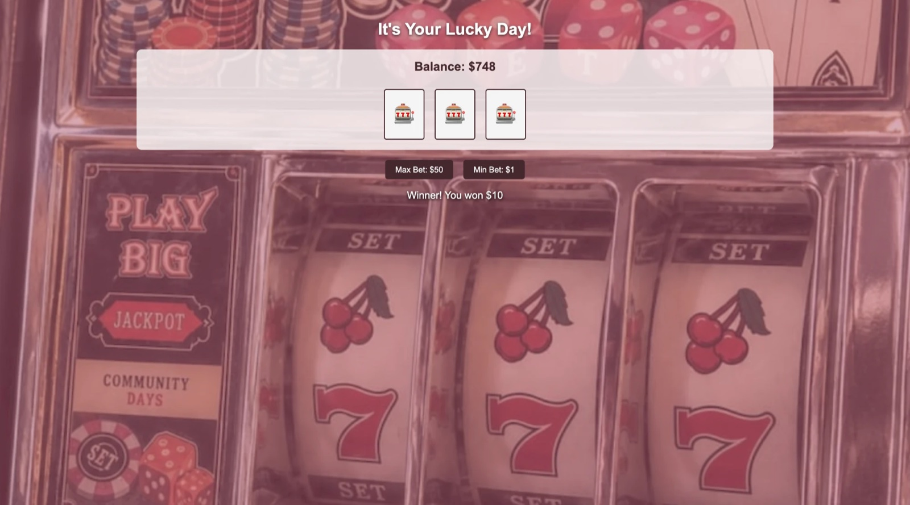

# Slot Machine 🎰

A simple slot machine game where you spin three reels and try to win play money.

## Description

This is a project I built to practice JavaScript logic: random numbers, arrays, and `if` statements. You start with $1,000 of pretend money and pick a bet. Each spin picks three random symbols, and if all three match, you win ten times your bet. The page keeps track of your balance and tells you if you won or lost. It uses plain HTML, CSS, and JavaScript, so there is no server to run. It's just for fun, and no real money is involved.

## Screenshot

## Features

- Start with a $1,000 balance
- Two bet buttons: **Max Bet: $50** and **Min Bet: $1**
- Each spin picks three random symbols from five: 🍒 🎰 🤍 ⭐ 💕
- Match all three to win 10 times your bet (about 1 spin in 25 wins)
- Shows a message after each spin: "Winner! You won $10" or "You lost."
- Updates your balance after every spin
- Shows "Not enough money left!" if your bet is more than your balance
- Slot machine photo background with a pink tint

## Tech Used

- HTML
- CSS
- JavaScript

## How to Use

This app doesn't need a server or an API key.

1. Download or clone the project.
2. Open `index.html` in your browser (or use the Live Server extension in VS Code).
3. Click **Max Bet: $50** or **Min Bet: $1** to spin.
4. Watch the reels, the message, and your balance.

**Please note:** your balance starts over at $1,000 when you refresh the page.

## How It Works

1. When you click a bet button, `main.js` calls `spin()` with the bet amount (50 or 1).
2. If the bet is more than your balance, it shows a message and stops.
3. Otherwise it takes the bet out of your balance and picks three random symbols from the list.
4. It shows the symbols on the three reels.
5. If all three match, it adds ten times your bet to your balance and says you won. If not, it says you lost.
6. It updates the balance on the page.

## What I Learned

- How to pick a random item from an array with `Math.random()` and `Math.floor()`
- How to use `if` and `else` to decide a win or a loss
- How to change text on the page with `innerText`
- How to listen for clicks on more than one button with `addEventListener`
- How to keep track of a number (the balance) as the game goes on
- How to put a tinted photo behind the page with CSS

## Author

Maya Rose 🌹
